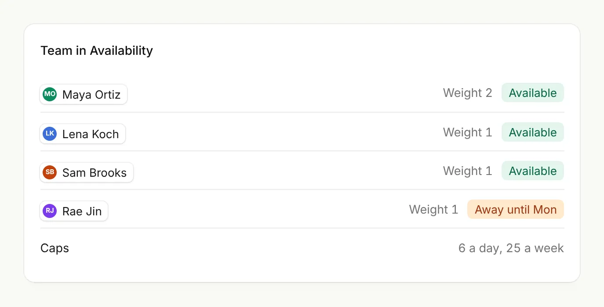

Plain round robin treats everyone the same. Each new lead goes to the next rep in line, and over time everyone gets an equal share. That's fair when everyone has the same job. It stops being fair when one rep is senior and another started last week, or when one person works full time and another works three days.

Weighted round robin fixes that. You give each person a weight, and they get turns in proportion to it. A rep with weight 2 gets about twice as many leads as a rep with weight 1, and the rotation still spreads them out so no one waits long for their next one.

> **[Try Claritia free](https://app.tryclaritia.com/signup)** to build a form that books the right teammate, then set weights for each rep with round robin on Pro.

This guide explains what weighted round robin means in networking and in sales, how it works, and how to set weights with simple worked examples.

## Main points

- Weighted round robin is round robin where each person or server gets a weight, and turns are shared in proportion to those weights.
- In networking, load balancers use it to send more requests to bigger servers. In sales, teams use it to send more leads to reps who can take them.
- To find each person's share, divide their weight by the total of all weights. Weights of 2 and 1 mean a 2 in 3 share and a 1 in 3 share.
- Good tools track who is most behind their share, so a rep who was busy for one meeting catches up on the next.
- Tools: [Claritia](/), [Cal.com](https://cal.com/), [Chili Piper](https://www.chilipiper.com/) and [Distribution Engine](https://www.distributionengine.com/). See [what round robin is](/blog/what-is-round-robin-scheduling) if you're new to the idea.

## What is weighted round robin?

Weighted round robin is a way of taking turns where some members get more turns than others. Each member gets a number called a weight, and over a full cycle each one gets a share of turns equal to their weight divided by the total.

A member with weight 2 gets two turns for every one turn that a member with weight 1 gets.

The idea is the same wherever it's used. Only the members change: servers in a network, or people on a team.

### Weighted round robin in networking

Many people first meet the term in load balancing. A load balancer sits in front of several servers and passes each new request to one of them. With plain round robin, each server gets the next request in turn. That works when the servers are the same size.

When they aren't, you give the bigger server a bigger weight. Say server A has three times the capacity of server B. Give A a weight of 3 and B a weight of 1, and A gets 3 of every 4 requests.

Many load balancers, NGINX among them, use round robin by default and let you set a weight for each server. Some also mix the turns up, so the bigger server doesn't get all of its requests in a row.

Weighted round robin doesn't look at how busy each server is right now. If that matters, load balancers have other methods, such as least connections, which sends each request to the server with the fewest open connections.

### Weighted round robin for sales teams

Sales teams use the same idea for leads and meetings. Each rep gets a weight, and new leads are shared in proportion to it. Common reasons to weight reps differently:

- **Experience.** Senior reps take more meetings than new hires.
- **Hours.** A part-time rep takes fewer than a full-time one.
- **Ramp-up.** A new hire starts low and moves up as they learn.
- **Other work.** A rep who also manages the team takes fewer calls.

## How weighted round robin works

Here's how a scheduling tool handles a weighted rotation when a new lead books:

1. **You set the weights.** For example, Maya 2, Lena 1 and Sam 1.
2. **The tool works out each share.** The total is 4, so Maya's share is 2 in 4, or half. Lena and Sam each get a quarter.
3. **A lead picks a time.** The booking page shows every time at least one rep is free.
4. **The tool finds who is free.** Only reps free at that time can take it.
5. **The tool picks who is most due.** Among the free reps, it picks the one furthest behind their share.
6. **The counts update.** The next lead starts from the new counts.

Step 5 is what keeps things fair. A tool that only follows a fixed order can let someone fall behind when they're busy. A tool that tracks shares gives them the next leads until they catch up.

## Examples

### Example 1: two reps, weights 2 and 1

Rep A has weight 2 and rep B has weight 1. The total is 3, so A's share is 2 in 3 and B's share is 1 in 3. If both are always free, the first six leads could go like this:

| Lead | Goes to | A's count | B's count |
|---|---|---|---|
| 1 | A | 1 | 0 |
| 2 | B | 1 | 1 |
| 3 | A | 2 | 1 |
| 4 | A | 3 | 1 |
| 5 | B | 3 | 2 |
| 6 | A | 4 | 2 |

After 6 leads, A has 4 and B has 2. Over 30 leads, A gets about 20 and B gets about 10. The exact order can differ from tool to tool. The shares are what stay the same.

### Example 2: three reps and a busy week

Maya has weight 2, and Lena and Sam have weight 1 each. The total is 4. If the team books 40 meetings in a week, Maya's share is about 20, and Lena and Sam get about 10 each.

Now add a daily cap of 6 meetings for each person. On a busy Monday, Maya reaches 6 by noon. She drops out for the rest of the day, and Lena and Sam take the afternoon. On Tuesday, Maya is furthest behind her share, so she gets the first few leads.

*A similar setup in Claritia: Maya has weight two, the others have weight one, and caps limit meetings per day and per week.*

### Example 3: catching up after a busy slot

Rep A has weight 2 and rep B has weight 1. After 6 leads, A should have 4 and B should have 2. But A was in meetings for two of the slots that leads picked, so B took them. Now A has 2 and B has 4.

A tool that follows a fixed order would carry on as if nothing happened. A tool that tracks shares sees A is 2 behind, so the next leads A is free for go to A until the counts are back in line.

### Example 4: ramping up a new hire

A new rep joins a team of two senior reps who each have weight 3. In their first month, the new rep gets weight 1, so they take 1 in 7 leads. In the second month, raise it to 2, for 2 in 8. By month three, at weight 3, they take a full third.

Some tools show weights as percentages instead. In [Cal.com](https://cal.com/), a host at 150% gets one and a half times the calls of a host at 100%. The math works the same way.

## Weighted vs plain round robin

| | Plain round robin | Weighted round robin |
|---|---|---|
| Share of turns | Equal for everyone | In proportion to each weight |
| Best for | Teams where everyone does the same job | Mixed teams, part-time staff, new hires |
| Setup | Add people to the team | Add people and set a weight for each |
| Upkeep | Very little | Review weights as roles change |

## Best practices

- **Base weights on capacity.** Use hours, experience and other duties. Keep the numbers small and simple, like 1, 2 and 3.
- **Use caps with weights.** A weight sets the share. A daily or weekly cap sets a ceiling, so no one gets buried on a busy day.
- **Use away days for time off.** Mark people as away instead of changing their weight. Their share comes back on its own when they return.
- **Route first, then rotate.** A form can send enterprise leads to one team and small accounts to another, and each team can have its own weights.
- **Check the counts each month.** If the split looks wrong, change the weights rather than moving meetings by hand.
- **Explain the weights.** Reps trust a rotation more when they can see the rules and a log of who got what.

## Tools for weighted round robin

### Claritia

[Claritia](/) is a forms, scheduling and follow-up app built for small B2B teams that want every lead from their website to reach the right rep and book a meeting before they leave the page.

It builds forms from a sentence or one of 840 templates, opens the right person's calendar the moment the form is sent, routes each lead by its answers, and drafts follow-up emails in your brand's voice for you to approve.

Round robin with weights and priority is on Pro. You set a weight for each person, people who are away or at their daily or weekly cap are skipped, and the most due person gets the next lead.

Forms can send each lead to the right team pool first, and each meeting shows the rule that matched and why that person was picked.

*Claritia's routing log shows why Lena got this lead, including how many meetings she already has this week.*

Claritia is a newer tool, with a smaller marketplace and no Zapier or Make apps listed yet. See [Claritia routing](/products/routing).

### Cal.com

[Cal.com](https://cal.com/) is scheduling software for individuals and companies that want booking links they can shape around their own process. It syncs calendars, detects time zones, sends reminders, and runs video calls through Zoom, Google Meet, Microsoft Teams, or its own Cal Video.

Teams can use round robin, collective events where every host must be free, routing forms, and workflows, plus admin tools such as SAML SSO and audit logs. Its source code is published on GitHub.

Its Teams plan has round robin with priority and optional weights, set as percentages. Among the hosts free at the chosen time, the host furthest behind their share gets the booking. Teams is $12 a user a month billed yearly ($16 monthly).

### Chili Piper

[Chili Piper](https://www.chilipiper.com/) is a meeting booking and lead routing platform for B2B revenue teams that want inbound buyers to book with the right rep right away. When someone submits a form, it qualifies them, routes them by rules such as company size, region or account owner, and shows that rep's calendar on the spot.

It also routes Salesforce records by rep workload, identifies visiting companies, runs an AI chat, blocks fake bookings and sends reps a brief before each meeting. It lists weighting, caps and meeting limits among its distribution features, along with round robin across reps and teams. Its Growth plan starts at $1,250 a month with 15 seats included.

### Distribution Engine

[Distribution Engine](https://www.distributionengine.com/) is a lead routing and case assignment app built inside Salesforce for revenue operations teams and Salesforce admins who want every record to reach the right rep fast, without writing code.

It assigns leads, cases and other records by round robin, territory, skills, workload, availability and account ownership, matches inbound leads to existing accounts, and reassigns work that misses its response target.

A companion product, Booking Engine, books meetings and hands qualified leads to reps inside Salesforce. Its plans list round robin, load balancing, and weighting and caps. Plans are $20, $35 and $55 a user a month with annual billing, and there's a 30-day free trial.

For more tools, see our guides to [round robin scheduling software](/blog/best-round-robin-scheduling-software) and [lead routing software](/blog/best-lead-routing-software).

## Questions

### What is weighted round robin in load balancing?

It's a way to share requests across servers of different sizes. Each server gets a weight, and bigger weights get more requests. A server with weight 3 gets three requests for every one sent to a server with weight 1.

### What's the difference between round robin and weighted round robin?

Plain round robin gives everyone an equal share. Weighted round robin gives each member a share based on their weight, so some get more turns than others.

### How do I choose weights for my sales reps?

Start from capacity. Give full-time, experienced reps a higher weight and new or part-time reps a lower one. Keep the numbers small, and review them each month.

### What happens when a weighted rep is on vacation?

In most tools, they drop out while they're away. In Claritia, away days remove a person from the rotation until they're back, and their weight stays as it was.

### Does weighted round robin look at how busy someone is?

Not by itself. It shares turns by weight. Scheduling tools add calendar checks, so only people free at the chosen time can take the meeting, and caps stop anyone from taking too many.

### Which Claritia plan has weighted round robin?

Pro, at $39 a seat a month or $31 billed yearly. Business adds owner first and double round robin.

## Get started

Set weights that match how much each person can take, and let the rotation keep the counts fair.

> **[Try Claritia free](https://app.tryclaritia.com/signup)** to build your first booking form, then turn on weighted round robin with caps and away days on Pro.

You can also see how [routing](/products/routing) and [meetings](/products/meetings) work together, or compare [plans](/pricing).
