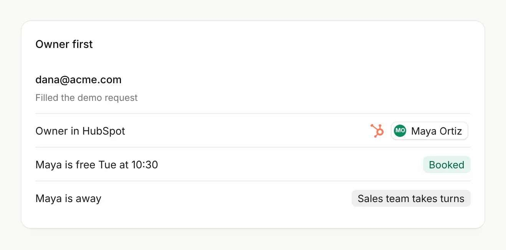

Every new lead raises the same question: who should talk to this person? On a small team, someone reads the inbox and passes leads on by hand. That works until the team grows, a rep goes on holiday, or two people answer the same lead while a third lead waits all weekend.

Lead routing answers it with rules. Each lead goes to one clear owner, fast, and you can see why it went there. Get it right and your reps spend their time talking to buyers, not sorting them.

> **[Try Claritia free](https://app.tryclaritia.com/signup)** to route each form lead to the right rep by its answers, with the meeting booked on the same page.

Below: how routing works, the main types, a few examples, and the tools that do it.

## Main points

- Lead routing is the set of rules that decides which person or team gets each new lead.
- The main types are round robin, territory, owner-based and account matching. Most teams mix two or three.
- Good routing has a fallback for leads no rule matches, and a log that shows why each lead went where it did.
- Routing works best when the lead can book a meeting with the chosen rep right away.
- Tools to look at: [Claritia](/) for form leads, [LeanData](https://www.leandata.com/) and [Distribution Engine](https://www.distributionengine.com/) for Salesforce, and [Chili Piper](https://www.chilipiper.com/) for large sales teams.

## What is lead routing?

Lead routing is the process of assigning each new lead to the right sales rep or team, based on rules you set.

The rules can look at what the lead told you, such as company size or country, or at what your CRM already knows, such as who owns the account. Every lead gets one owner in seconds, so none is missed or answered twice.

You'll also hear it called lead assignment or lead distribution. Most people use the three terms for the same thing.

## How lead routing works

Most routing follows the same five steps, whether a spreadsheet or software does the work:

1. **A lead comes in.** Someone fills in a form, books a demo, starts a chat or is added from a list.
2. **The lead is checked.** The router reads the answers and looks the person up in your CRM. Is this a new lead or a contact you already know?
3. **Rules pick a team.** The first rule that matches wins. For example, companies with more than 50 people go to the enterprise team.
4. **The team picks a person.** Round robin, the account owner or a territory map chooses one rep. People who are away or full are skipped.
5. **The rep gets the lead.** The owner is set in your CRM, the rep gets an alert, and in the best setups the lead books a meeting with that rep on the spot.

A good router also keeps a record of each choice. When a rep asks "why did I get this one?", you can answer in a click.

*Claritia's log shows which rule matched a lead and why Lena got the meeting.*

## Types of lead routing

### Round robin

Round robin hands leads to each rep in turn, so everyone gets a fair share. Weighted round robin gives some reps more than others, for example a senior rep who can take twice as many. Start here if you're new to routing. Read more in our guide to [round robin scheduling software](/blog/best-round-robin-scheduling-software).

### Territory routing

Territory routing sends leads by place or segment. One rep covers Germany, another covers the US West Coast, and a third covers companies above a certain size. Use it when reps need local knowledge, a time zone or a language.

### Owner-based routing

Owner-based routing, also called owner first, sends a lead to the rep who already owns that person or account in your CRM. If a customer of yours fills in a form, they go back to the rep they know instead of a stranger. If the owner is away, a fallback picks someone else.

### Account matching

Account matching, also called lead-to-account matching, links a new lead to a company that's already in your CRM. A lead from jane@acme.com is matched to the Acme account, then sent to the Acme account owner. This matters most in B2B sales, where several people from one company may reach out weeks apart.

### Rules by answer

Many teams also route on the answers in the form. A lead who picks "Enterprise" sees the enterprise demo. A lead with a small budget gets a guide by email instead of a sales call. This is often the first rule in the chain, before round robin picks the person.

*Claritia's routing rules send each lead to a meeting or a rep based on its answers.*

## Examples of lead routing

- **A small agency:** Every contact form lead goes to the three founders in turn. If one is on holiday, the other two share the leads.
- **A software company:** Leads from companies with 1 to 50 people go to the small business team by round robin. Larger companies go to the enterprise team. A known account goes to its owner.
- **A business with regions:** A lead from Germany goes to the German-speaking rep. Leads from countries with no assigned rep go to a shared team.
- **An SDR team:** Every new lead goes to an SDR first. After a qualifying call, the SDR books the right account executive.

## Best practices

- **Start with a few rules.** Three to five clear rules beat thirty that nobody can explain. Add more only when a real gap shows up.
- **Always have a fallback.** A catch-all rule at the end makes sure no lead is left with no owner.
- **Ask for what routing needs.** You can only route on what you know. Ask for country, company size or need in the form, with set choices instead of free text.
- **Skip people who can't take leads.** Away days and daily caps keep leads from piling up with one person.
- **Book the meeting right away.** A lead with an owner still has to hear from them. Letting the lead pick a time with that rep removes the wait.
- **Check the log.** Look at where leads went each week, and fix the rule when something looks off.

## Common mistakes

- **Routing by hand for too long.** A shared inbox works until one busy week, then leads wait.
- **No owner check.** A current customer lands with a new rep, and the customer has to explain everything again.
- **Rules that overlap.** Two rules match the same lead, and nobody knows which one should win. Put your rules in order, so the first match wins.
- **Forgetting about time off.** A rep on holiday keeps getting leads and nobody answers them.

## Tools for lead routing

Lead routing tools fall into two groups. Some live inside Salesforce and handle territories across thousands of accounts. Others start from a web form and book the meeting in the same step. For a full comparison with prices, see our list of the [best lead routing software](/blog/best-lead-routing-software).

### Claritia

[Claritia](/) is a forms, scheduling and follow-up app for small B2B teams. It gets each website lead to the right rep and booked into a meeting before they leave the page.

It routes from the form itself. Rules read each answer and book the right meeting with the right person, then the team takes turns with weights, caps and away days. It also drafts follow-up emails in your brand's voice for you to approve.

Every booking keeps a note of which rule matched and why that person was picked. On Business, a lead who's already in HubSpot or Salesforce books with their owner first. Routing by answer starts on Pro at $39 a seat a month ($31 billed yearly). See how [Claritia routing](/products/routing) works.

*With owner first, a lead Maya owns in HubSpot books with Maya, and the team takes turns when she's away.*

### LeanData

[LeanData](https://www.leandata.com/) is a revenue orchestration platform for B2B marketing, sales, operations and customer success teams that want every lead and account handled by the right person. It matches leads to accounts and opportunities, routes them by territory rules, round robin and service levels, and keeps an audit trail of each decision. Its Salesforce support goes deep.

Its BookIt tool lets prospects schedule with the assigned rep, and Journeys tracks buying groups across a deal. Its Standard edition covers round robin, territory and account-based routing, plus lead-to-account matching, and higher editions add contacts, accounts and any Salesforce object. Pricing is by quote, and onboarding is billed apart.

### Distribution Engine

[Distribution Engine](https://www.distributionengine.com/) is a lead routing and case assignment app built inside Salesforce. It's for revenue operations teams and Salesforce admins who want every record to reach the right rep fast, without writing code.

It assigns leads, cases and other records by round robin, territory, skills, workload, availability and account ownership, matches inbound leads to existing accounts, and reassigns work that misses its response target.

A companion product, Booking Engine, books meetings and hands qualified leads to reps inside Salesforce. It installs from the Salesforce AppExchange and publishes its prices, from $20 a user a month billed yearly, with a minimum of 5 licenses and a 30-day free trial.

### Chili Piper

[Chili Piper](https://www.chilipiper.com/) is a meeting booking and lead routing platform for B2B revenue teams that want inbound buyers to book with the right rep right away. When someone submits a form, it qualifies them, routes them by rules such as company size, region or account owner, and shows that rep's calendar on the spot.

It also routes Salesforce records by rep workload, identifies visiting companies, runs an AI chat, blocks fake bookings and sends reps a brief before each meeting. It works with Salesforce and HubSpot, and its Growth plan starts at $15,000 a year with 15 seats, billed yearly only.

Prices checked November 2026. If you run your CRM in one place, these guides walk through the built-in options: [lead routing in Salesforce](/blog/salesforce-lead-routing) and [HubSpot lead routing](/blog/hubspot-lead-routing).

## Questions

### What is lead routing in sales?

Lead routing in sales is how new leads are assigned to sales reps. Rules look at the lead's answers and your CRM data, then pick one rep or team, so every lead gets a fast reply from the right person.

### What is the difference between lead routing and lead distribution?

Most teams use them to mean the same thing. When there is a difference, lead distribution means sharing leads fairly across a team, like round robin, and lead routing covers the full set of rules that decide where each lead goes.

### What is round robin lead routing?

Round robin hands each new lead to the next rep in line, so everyone gets an equal share. Weighted round robin lets some reps take more leads than others.

### Do you need a CRM for lead routing?

No. You can route from form answers alone, which Claritia does on Pro. A CRM helps when you want owner-based routing or account matching, since those need to know who owns each person or company.

### How fast should a lead be routed?

In seconds, if you can. Software can do that, and the best setups let the lead book a meeting with the chosen rep before they leave the page.

## Get started

Write down who should get which lead, add a fallback, then let software do the sorting. Start with round robin and one or two rules, and add more as you learn.

> **[Try Claritia free](https://app.tryclaritia.com/signup)** to build a form that routes each lead to the right rep and books the meeting in one step.

You can also read how [Claritia routing](/products/routing) works or compare the [best lead routing software](/blog/best-lead-routing-software).
