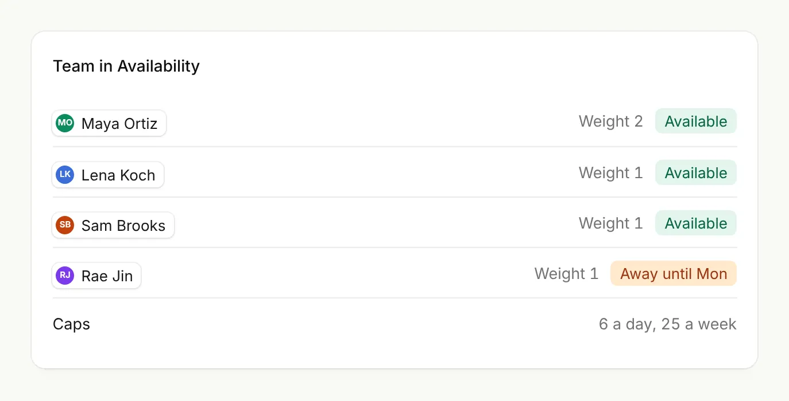
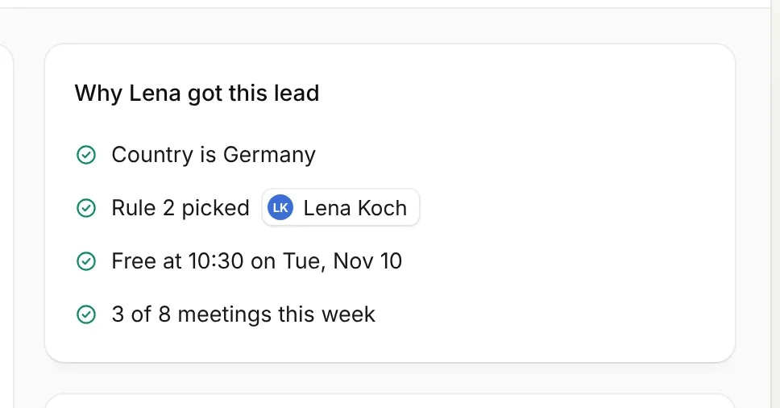

You hear "round robin" in sports, in computing and in sales meetings, and it seems to mean something a little different each time. It doesn't. In every case, it means taking turns in a fixed order so everyone gets a fair share.

For a sales or support team, that idea solves a real problem. Without it, new meetings pile up on whoever answers first or whoever owns the shared inbox.

One person gets buried, another sits idle, and leads wait for a reply. Round robin scheduling hands each new meeting to the next person in line, so the work stays even and leads get a time sooner.

> **[Try Claritia free](https://app.tryclaritia.com/signup)** to build a form that books the right teammate, then share meetings across your team with round robin on Pro.

This guide explains what round robin means, how round robin scheduling works for meetings and leads, and how to set it up well.

## Main points

- Round robin means taking turns in a fixed order, so each person or item gets an equal share.
- Round robin scheduling gives each new meeting or lead to the next person on a team, and skips anyone who isn't free.
- Most tools add weights, caps and away days on top of the basic rotation.
- A form before the booking can send each lead to the right group first, then the rotation picks a name.
- Tools: [Claritia](/), [Calendly](https://calendly.com/), [Cal.com](https://cal.com/), [HubSpot](https://www.hubspot.com/) and [Zcal](https://zcal.co/). Compare them in our [round robin scheduling software](/blog/best-round-robin-scheduling-software) guide.

## What is round robin?

Round robin is a way of taking turns. Each person, team or task gets a turn in a fixed order, and when the last one has had a turn, the order starts again from the top. The goal is fairness: no one gets skipped, and no one gets more than their share.

The name is often linked to old petitions where people signed in a circle, so no single name sat at the top of the list. The idea of a circle with no first place stuck.

### Where you'll see the word

- **Sports and games.** In a round robin tournament, every team plays every other team. The winner has the best record across all games.
- **Computers.** An operating system gives each running program a short slice of time in turn, so every program keeps moving.
- **Networks.** A load balancer sends each new request to the next server in its list, so no one server gets overloaded. Our post on [weighted round robin](/blog/weighted-round-robin) covers the version that gives bigger servers more requests.
- **Sales and meetings.** Each new lead or booking goes to the next rep or teammate in line. That's what the rest of this guide covers.

## What is round robin scheduling?

Round robin scheduling is a way to share new meetings across a team. When someone books, the tool picks the next person in the rotation who is free at that time, and puts the meeting on their calendar. The person booking sees one page with every open time, and doesn't have to choose a rep.

Sales teams use the same idea for leads. Each new lead from a form, chat or ad goes to the next rep in line. Round robin lead routing is often paired with scheduling, so the lead books a meeting with that rep on the spot.

## How round robin scheduling works

Here's what happens in a typical tool when a lead books a demo:

1. **You build a team.** You add the people who take this kind of meeting, like four sales reps.
2. **The tool reads every calendar.** It checks each person's busy times.
3. **The booking page shows every open time.** A time shows if at least one person on the team is free.
4. **The visitor picks a time.** They see one page and one set of times.
5. **The tool picks the person.** Among the people free at that time, it picks whoever is next in line or most due for a meeting.
6. **The meeting lands on their calendar.** Both sides get an invite, and the rotation moves on.

With three reps, Ana, Ben and Cara, a plain rotation looks like this. Lead 1 goes to Ana, lead 2 to Ben, lead 3 to Cara and lead 4 back to Ana.

If Ben is in another meeting when lead 5 wants 2 pm, the tool skips him for that slot and gives it to the next free person. Good tools then give Ben the next lead he's free for, so he doesn't fall behind.

## Types of round robin

Plain turn-taking is the starting point. Most teams add one or more of these:

- **Equal rotation.** Everyone gets the same share, one after another.
- **Weighted.** Some people get more meetings than others. A senior rep with weight 2 gets about twice the meetings of a new rep with weight 1. See [weighted round robin](/blog/weighted-round-robin) for worked examples.
- **Priority.** Some people get first pick of open times, and others take what's left.
- **Availability first.** The tool books whoever is free, and cares less about keeping counts even.
- **Caps.** Each person has a daily or weekly limit, and drops out once they reach it.
- **Away days.** People on leave drop out of the rotation until they're back.
- **Owner first.** A lead who already has an owner in your CRM books with that owner, and the rotation only covers new leads.

*Caption: In Claritia, Maya has weight 2 and the others have weight 1. One rep is away until Monday, and caps limit each day and week.*

## Examples of round robin scheduling

- **Demo requests.** A software company sends every demo request to its four account executives in turn.
- **Inbound sales by region.** A form asks for the country. Leads from Germany go to the German team's rotation, and everyone else goes to the main team.
- **Support calls.** Customers book onboarding calls, and the support team shares them evenly.
- **Recruiting.** Candidates book first interviews, and the recruiters on a role take turns.
- **Agencies.** New client inquiries go to the next free strategist.

## Best practices

- **Ask first, then rotate.** A short form can send each lead to the right team before the rotation picks a name. Enterprise leads shouldn't land with a rep who only handles small accounts.
- **Keep calendars honest.** Round robin only works if busy times are real. Make sure everyone connects the calendar they really use.
- **Set caps.** A daily or weekly limit keeps one person from taking every call in a busy week.
- **Mark time off.** Away days stop the tool from booking someone who is on vacation.
- **Check the counts.** Look at who got how many meetings each week. If it's off, change weights instead of moving meetings by hand.
- **Keep a log.** When a lead asks why they got a certain rep, or a rep asks why they got fewer leads, a log of each decision gives the answer.

### Common mistakes

- **Giving every lead to the same pool.** Big accounts and small ones need different people.
- **Forgetting known leads.** A returning customer should book with the person they already know.
- **Turning on round robin without reminders.** A fair rotation still loses meetings to no-shows.

## Tools for round robin scheduling

### Claritia

[Claritia](/) is a forms, scheduling and follow-up app built for small B2B teams that want every lead from their website to reach the right rep and book a meeting before they leave the page.

It builds forms from a sentence or one of 840 templates, opens the right person's calendar the moment the form is sent, routes each lead by its answers, and drafts follow-up emails in your brand's voice for you to approve.

The form answers pick the team, and the rotation picks the person. Round robin on Pro comes with weights and priority, team pools, away days and daily and weekly caps.

Every meeting shows the rule that matched and why that person was picked, and Business adds owner first.

*Caption: The log for one lead shows the rule that matched and why Lena got the meeting.*

Claritia is a newer tool with a smaller marketplace, and its Zapier and Make apps aren't listed yet.

### Calendly

[Calendly](https://calendly.com/) is scheduling software for professionals and teams who want people to book meetings without trading emails. You connect your calendars, set hours, buffers, and daily limits, and share booking links for one-on-one, multi-host, or group meetings. It sends email and text reminders, offers routing forms that send website leads to the right teammate, and collects payments.

Newer tools include an AI assistant that finds times over email and a notetaker that writes meeting recaps. Round robin, team scheduling and routing forms come on its Teams plan, at $16 a seat a month billed yearly.

### Cal.com

[Cal.com](https://cal.com/) is scheduling software for individuals and companies that want booking links they can shape around their own process. It syncs calendars, detects time zones, sends reminders, and runs video calls through Zoom, Google Meet, Microsoft Teams, or its own Cal Video.

Teams can use round robin, collective events where every host must be free, routing forms, and workflows, plus admin tools such as SAML SSO and audit logs. Its source code is published on GitHub.

Its Teams plan has round robin with priority and optional weights. You choose between booking whoever is free and load balancing that pauses hosts who get too far ahead. Teams is $12 a user a month billed yearly.

### HubSpot

[HubSpot](https://www.hubspot.com/) is a customer platform for businesses of all sizes that want their marketing, sales and customer service teams to work from the same customer data. It is built around a shared CRM and adds separate products, called hubs, for marketing, sales, service, content, data management, and quotes and billing.

Teams use it to capture leads with forms and chat, send email campaigns, manage deals, run a help desk, build web pages and set up AI agents. Its meetings tool offers round robin links that book the first available rep, and team links need a paid Sales Hub plan.

### Zcal

[Zcal](https://zcal.co/) is a scheduling app for individuals, teams, and class hosts who want booking pages and meeting polls in one place. Booking pages can carry custom fonts, colors, layouts, welcome videos, and custom questions, and they sync with Google, Outlook, and Apple calendars.

Teams can use round robin and collective events, while group events, sign-up sheets, and polls handle classes and groups. It sends confirmations and reminders and connects to Zoom, Stripe, and Zapier. Round robin events come on Pro, at $7 a user a month billed yearly.

## Questions

### What does round robin mean in simple terms?

It means taking turns in a fixed order. Each person gets a turn, and when everyone has had one, it starts again.

### What is a round robin in sports?

It's a format where every team plays every other team. The team with the best record wins, so no one is knocked out by one bad game.

### How does round robin work in sales?

Each new lead or meeting goes to the next rep in line. Most tools skip reps who aren't free and let you give some reps more leads with weights.

### What happens if the next person is busy?

The tool skips them for that time and books the next free person. Good tools then give the skipped person a later meeting, so the counts stay fair.

### Is round robin the same as lead routing?

Not quite. Lead routing decides which team or person a lead should go to, often from form answers. Round robin is one way to pick a person within that team.

### Do you need a paid plan for round robin?

Usually, yes. Most tools put round robin on a team plan. In Claritia, it's on Pro, at $39 a seat a month or $31 billed yearly.

## Get started

Start with a simple rotation, then add weights, caps and away days as your team grows.

> **[Try Claritia free](https://app.tryclaritia.com/signup)** to build your first booking form, then turn on round robin with weights and away days on Pro.

You can also see how [Claritia routing](/products/routing) picks the meeting and the person, or compare [round robin scheduling software](/blog/best-round-robin-scheduling-software).
