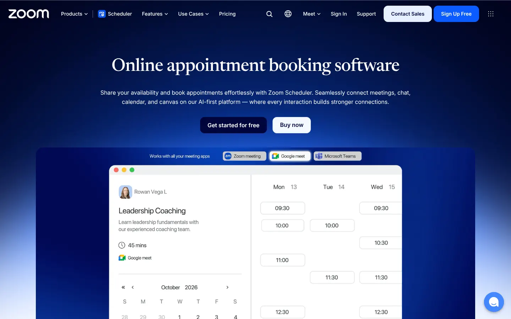

Booking a Zoom call with a client or a lead often takes more work than the call itself. You trade a few emails to find a time, then open Zoom, make a meeting, copy the link and paste it into an invite. Do that ten times a week and it adds up, and one wrong paste sends someone to the wrong room.

A Zoom meeting scheduler turns all of that into a link. The other person opens it, sees only the times you're free, picks one, and both of you get an invite with a fresh Zoom link inside. Zoom has its own way to do this, and booking tools that connect to Zoom can do it too, some of them from a form.

> **[Try Claritia free](https://app.tryclaritia.com/signup)** to make a Zoom link for every meeting booked from your page or form, on the host's own Zoom account, on every plan.

In this guide, we show how to let people book Zoom meetings from a link or a form, step by step, plus fixes for the problems people hit most.

## Main points

- Zoom's own booking app, [Zoom Scheduler](https://www.zoom.com/en/products/appointment-scheduler/), costs $4.99 a user a month billed yearly, or comes with Zoom Workplace Business. Zoom's free plan includes only limited Scheduler features.
- A booking tool like [Claritia](/) connects to your Zoom account and your Google or Outlook calendar, and creates a new Zoom meeting for each booking.
- Each host should connect their own Zoom, so meetings run under their name and follow their Zoom plan's limits.
- Google Calendar's own booking pages can't add a Zoom link by themselves. You'd have to add it to each event by hand.
- Other options: [Calendly](https://calendly.com/), [Cal.com](https://cal.com/) and [YouCanBookMe](https://youcanbook.me/) all add Zoom links, even on their free plans.

## What you need

Before you start, check these four things:

- **A Zoom account for each host.** Free Zoom accounts work in Claritia, though Zoom's free plan limits meetings to 40 minutes.
- **A Google or Outlook calendar.** The scheduler reads it so people only see times you're free.
- **Your working hours.** Decide which days and times you take calls, and how much break you need between them.
- **A place to share the link.** Your email signature, your website, or the end of a form.

## Step 1: Pick the right route

Each route fits a different job. Pick one before you set anything up.

| Route | Best for | Who picks the time | Extra cost |
|---|---|---|---|
| Zoom's Schedule button | One meeting you set yourself | You | Free with any Zoom account |
| Zoom Scheduler | People who live in Zoom | The guest, from your booking page | $4.99 a user a month billed yearly, or in Workplace Business |
| A booking tool connected to Zoom | Most people, any calendar | The guest, from a link | Free to start in most tools |
| A form that ends in booking | Leads from your website | The guest, after your questions | Free to start in Claritia |

Zoom's Schedule button is the classic way: you pick a time and invite people, so it doesn't let anyone choose for themselves. If you want others to pick, go to Step 2 or Step 3. If the meeting starts on your website, Step 4 fits better.

## Step 2: Use Zoom Scheduler

Zoom Scheduler is Zoom's booking app. It lets people book time with you from a booking page, and Zoom says every booking makes its own Zoom link, invite and reminders without extra setup.

1. Start a free trial of Scheduler, or check whether your company's Zoom Workplace Business or Enterprise plan already includes it.
2. Connect your calendars. Zoom lists Zoom, Google, Microsoft 365, Outlook.com and iCloud calendars, up to six of them.
3. Create a booking page for one-on-one calls, or a group page where several people can book the same slot.
4. Set your hours and the questions you want guests to answer.
5. Pick Zoom as the place to meet. Scheduler can also add Google Meet, Microsoft Teams or Webex links.
6. Share the booking page link by email or on your site.

Zoom's help center lists the exact clicks for each step. On a paid Scheduler seat you also get email and SMS reminders, round robin, routing forms and Stripe payments, which Zoom says work in the US and UK.

## Step 3: Or use a booking tool connected to Zoom

A booking tool makes sense if you don't want another Zoom add-on, or if you need a feature Zoom doesn't have, like booking inside a form. Here's how it works in [Claritia](/):

1. Open **Meetings** and connect your Google Calendar or Outlook.
2. Connect Zoom. Each host signs in with Zoom once, so meetings are made on their own account.
3. Open a meeting type and set its location to **Zoom**.
4. Set working hours, buffers, notice and daily caps.
5. Share the booking page, or put it in an email.

From then on, each booking makes a new Zoom meeting on the host's account. The join link goes on the calendar event and on the guest's invite. If a step ever has to run again, Claritia reuses the Zoom meeting it already made, so a guest never gets two links. See the [Zoom integration](/integrations/zoom) for the details.

## Step 4: Put the booking inside a form

When your Zoom calls come from your website, a plain link loses you the chance to ask questions first. A form that ends in booking fixes that.

1. In Claritia, build a form from a sentence or start from one of 840 [templates](/templates), such as a demo request or a discovery call.
2. Add booking to the last page and pick the meeting type you set up with Zoom.
3. Embed the form on your site with one script tag, or share it by link.

The visitor answers your questions, then picks a time on the same page, with their name and email already filled in. The Zoom link is made as soon as they book. On Pro, round robin shares the calls across your team, and the Zoom meeting is made on the account of the person who gets the lead.

## Step 5: Test your link

Before you share the link widely, book a meeting with yourself from a private browser window. Check four things:

- The invite shows a Zoom link, and it opens the right meeting.
- The meeting is hosted on the right person's Zoom account.
- The time shows in the right time zone.
- The slot you booked is gone from the page right after.

## Common problems

- **No Zoom link on bookings.** Check that the meeting type's location is set to Zoom and that the host has connected their Zoom account.
- **Calls end after 40 minutes.** The host is on Zoom's free Basic plan, which limits meetings to 40 minutes. The booking tool can't change Zoom's own limits.
- **Round robin calls land on the wrong account.** Each host in the pool needs to connect their own Zoom. Otherwise the meeting can't be made under their name.
- **Your Google booking page has no Zoom option.** Google's appointment schedules offer Google Meet, in person, phone or none. Google says to pick none and add your Zoom link to the event after someone books.
- **Guests get no reminders.** On Zoom Scheduler's free tier and on Calendly's free plan, automated reminders aren't included. Claritia sends reminders a day and an hour before on every plan.
- **People book over busy times.** Make sure every calendar you use is connected and counts as busy. Free plans in most tools check only one calendar.

## Tools for scheduling Zoom meetings

### Claritia

[Claritia](/) is a forms, scheduling and follow-up app built for small B2B teams that want every lead from their website to reach the right rep and book a meeting before they leave the page.

It builds forms from a sentence or one of 840 templates, opens the right person's calendar the moment the form is sent, routes each lead by its answers, and drafts follow-up emails in your brand's voice for you to approve.

Zoom links are on every plan, Free included. Each booking makes a new Zoom meeting on the host's own account, with Google Calendar or Outlook. The free plan has one meeting type on one calendar, and Claritia is a newer tool, with a smaller marketplace and no Zapier or Make apps listed yet.

### Zoom Scheduler

[Zoom Scheduler](https://www.zoom.com/en/products/appointment-scheduler/) is Zoom's booking app for small businesses and sales, support and HR teams that want clients and candidates to book time without trading emails. You share a booking page, and people pick a slot that fits your connected calendars.

It handles one-on-one, group, round robin and collective meetings, runs polls to find a time, sends email and SMS reminders, and adds a Zoom, Google Meet or Teams link to each booking.

Zoom's FAQ says the free tier has one booking page, one calendar and automatic confirmations. Reminders, more pages, payments and team booking come with the $4.99 seat, billed yearly, or with Zoom Workplace Business. Zoom lists its Salesforce and Zapier connections as coming soon.

### Calendly

[Calendly](https://calendly.com/) is scheduling software for professionals and teams who want people to book meetings without trading emails. You connect your calendars, set hours, buffers, and daily limits, and share booking links for one-on-one, multi-host, or group meetings. It sends email and text reminders, offers routing forms that send website leads to the right teammate, and collects payments.

Newer tools include an AI assistant that finds times over email and a notetaker that writes meeting recaps. Zoom links work on every plan, and on Teams an admin can connect Zoom for the whole team. The free plan has one event type and no automated reminders.

### Cal.com

[Cal.com](https://cal.com/) is scheduling software for individuals and companies that want booking links they can shape around their own process. It syncs calendars, detects time zones, sends reminders, and runs video calls through Zoom, Google Meet, Microsoft Teams, or its own Cal Video.

Teams can use round robin, collective events where every host must be free, routing forms, and workflows, plus admin tools such as SAML SSO and audit logs. Its source code is published on GitHub. The free plan is for one user, with unlimited links and calendars.

### YouCanBookMe

[YouCanBookMe](https://youcanbook.me/) is an online scheduling tool for small and midsize businesses that want a branded booking page tied to their calendars. It syncs with Google, Apple, Outlook, and Fastmail calendars, and offers booking forms with conditional questions, approval of requests before they are confirmed, password protected pages, and paid bookings through Stripe.

It sends confirmations, reminders, and follow-ups by email and SMS, triggers webhooks, and reports on bookings, no-shows, and revenue. It connects to Zoom on its free plan, which allows 30 bookings a month on one booking page.

For more choices, see our list of the [best Calendly alternatives](/blog/best-calendly-alternatives).

## Questions

### Does Zoom have a meeting scheduler?

Yes. Zoom Scheduler lets people book time with you from a booking page, with a Zoom link made for each booking. It costs $4.99 a user a month billed yearly, or comes with Zoom Workplace Business and Enterprise.

### Is Zoom Scheduler free?

Zoom's free plan includes limited Scheduler features. Its FAQ lists one booking page, one calendar and automatic confirmations. Reminders, team booking and payments need a paid Scheduler seat.

### How do I make a booking link that creates a Zoom meeting?

Connect your calendar and your Zoom account to a booking tool, set the meeting's location to Zoom and share the link. In Claritia, each booking then gets its own Zoom meeting on the host's account.

### Can I use a free Zoom account with a booking tool?

Yes, in Claritia. Free Zoom accounts work there, and Zoom's own limits still apply, like the 40-minute cap on meetings.

### Can a team share one Zoom booking link?

Yes. Zoom Scheduler and Calendly offer round robin on paid plans. In Claritia, round robin is on Pro, and each Zoom meeting is made on the account of the person who gets the lead.

### Can people book a Zoom call from a form?

Yes, in Claritia. The visitor answers your form, then picks a time on the same page, and the Zoom link is made as soon as they book.

## Get started

Connect Zoom once, set it as the location on your meeting type, and stop pasting links into invites.

> **[Try Claritia free](https://app.tryclaritia.com/signup)** to connect Zoom and your calendar, and share your first booking link today.

You can also read about the [Zoom integration](/integrations/zoom) or see how [Claritia Meetings](/products/meetings) works.
